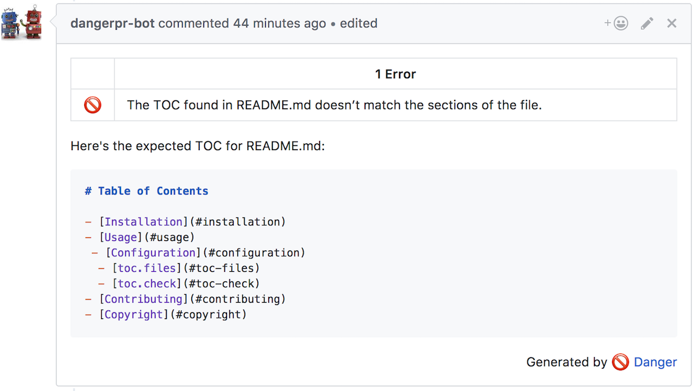

# danger-toc

A plugin for [danger.systems](https://danger.systems) that makes sure your project's `README.md` has a TOC. Requires Ruby 3.1 or newer.

[](https://badge.fury.io/rb/danger-toc)
[](https://github.com/dblock/danger-toc/actions/workflows/ci.yml)

## Table of Contents

- [Installation](#installation)
- [Usage](#usage)
  - [toc.files](#tocfiles)
  - [toc.header](#tocheader)
  - [toc.check!](#toccheck)
  - [TOC Options](#toc-options)
  - [Diff Reports](#diff-reports)
- [Contributing](#contributing)
- [Copyright](#copyright)

## Installation

Add `danger-toc` to your Gemfile.

```
gem 'danger-toc'
```

Add `toc.check!` to your Dangerfile. Make a pull request and see this plugin in action.



## Usage

Methods and settings from this plugin are available in your `Dangerfile` under the `toc` namespace.

### toc.files

List of files to ensure TOC in, default is `README.md`.

```ruby
toc.files = ['README.md', 'DEV.md']
```

### toc.header

The Table of Contents header, without `#`, default is `Table of Contents`.

```ruby
toc.header = 'Custom Table of Contents'
```

### toc.check!

Run all checks.

### TOC Options

```ruby
toc.bullet = '*'       # '-', '*', or '+'; default '-'
toc.indent = 4         # spaces per nesting level; default 2
toc.max_depth = 3      # absolute Markdown heading level (1–6); default nil (all)
toc.parser = 'Kramdown' # Kramdown input parser; default 'GFM'
toc.format = :kramdown # anchor format; default :github
toc.check!
```

Parser selection controls how Markdown is read; `format` controls generated anchor IDs. Install and require any additional Kramdown parser before selecting it. GFM and Kramdown input are available out of the box.

When a TOC is missing, a leading `# Title` is excluded if every subsequent heading is nested below it. A lone heading or multiple top-level sections are retained. When a TOC exists, headings before it are excluded as before.

### Diff Reports

Full expected TOCs remain the default. Set `toc.report = :diff` to show only mismatched entries with two surrounding entries of context. Removed lines are prefixed with `-`, additions with `+`. Missing TOCs always show the full suggested TOC.

```ruby
toc.report = :diff
toc.check!
```

## Contributing

See [CONTRIBUTING](CONTRIBUTING.md).

## Copyright

Copyright (c) Daniel Doubrovkine, 2017-2019

MIT License, see [LICENSE](LICENSE.txt) for details.
